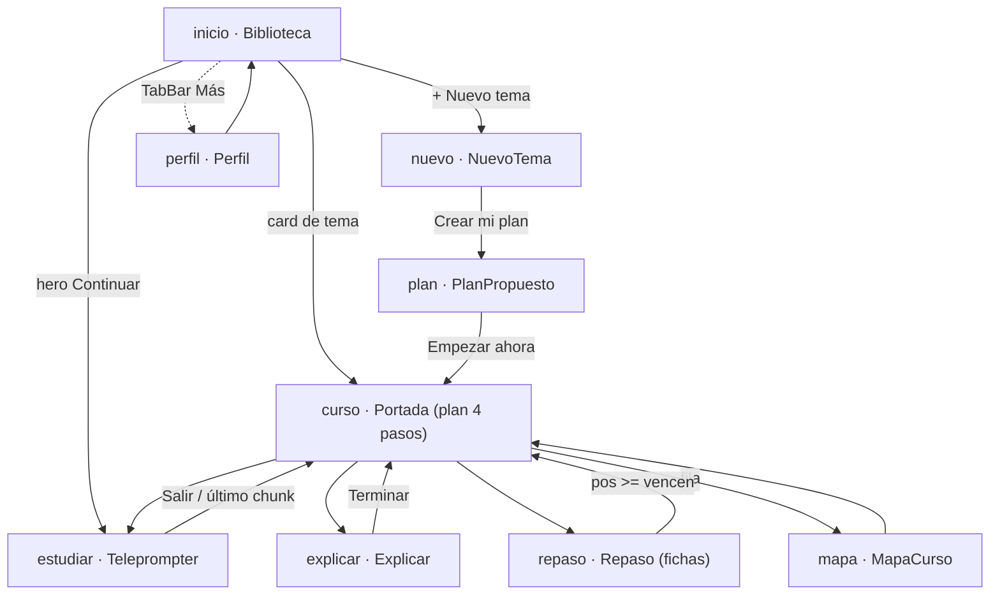

# Rediseño Klara v4 — "Biblioteca de conocimiento" — Plan maestro de ejecución

> **For agentic workers:** Este es el plan MAESTRO (roadmap + roster + decisiones). Cada fase abre con su propio plan detallado formato `superpowers:writing-plans` (tareas bite-sized con código y tests) antes de tocar código. Ejecutar fases con `superpowers:subagent-driven-development`.

**Goal:** Convertir Klara de "app de alemán" en una biblioteca de estudio multi-tema ("cada tema es un curso; idiomas es solo un tipo"), mobile-first, sin romper lo que ya vive en prod.

**Architecture:** Strangler fig en tres ejes. Eje UI: el shell v4 (tab bar, biblioteca, portada, cero-scroll 100dvh) envuelve las pantallas existentes y las reemplaza de a una. Eje dominio: la entidad `Course` se introduce como wrapper del dominio alemán existente (backfill del curso "Alemán" para el usuario real) y solo después se generaliza a tipos `tecnico`/`oral`. **Eje aprendiz (la tesis del producto):** un Perfil de Aprendizaje por usuario que Klara consulta al generar cualquier herramienta y actualiza con la evidencia de cada sesión — las herramientas de un curso son función de (tema × perfil), no del tema solo. El mockup (`docs/design/klara-v4/`) dicta el diseño visual — no se re-decide.

**Tech Stack:** React+TS+Vite (PWA existente), FastAPI+SQLAlchemy+Alembic (Postgres), LiteLLM/deepseek, ElevenLabs TTS, Azure STT. Sin dependencias nuevas hasta Fase 5 (parser PDF).

**Fuente de la revisión:** workflow `klara-v4-roster-review` (9 agentes, 2026-07-31). Reportes completos por agente en el output del workflow; lo esencial está sintetizado acá.

---

## Global Constraints

- **Mobile-first:** el frame objetivo es 430px, `100dvh`, cero scroll de página (`m3-app`). Desktop hereda el frame centrado. El foco del rediseño es la app móvil (PWA instalada).
- **Identidad heredada de DESIGN.md (solo identidad, no layout):** serif editorial (Source Serif 4), papel/tinta, UN acento bermellón, hairlines 1px, sin gradientes/glow/glassmorphism, sin mascotas.
- **Anti-Duolingo es constitucional:** sin streaks, sin corazones, sin guilt. La "Racha 21 días" del mockup (`mobile4-views.jsx:161`) **NO se porta** (contradice DESIGN.md; confirmado por Serrano F5 y Cassian).
- **Suscripción (69€) NO se porta:** app invite-only de un usuario. Se borra del scope (Cassian: DELETE). El estado `suscripcion` del router no se implementa.
- **`tweaks-panel.jsx` NO es producto:** tooling del canvas de diseño. No portar.
- **DESIGN.md queda marcado como superseded-en-layout** (tarea de 5 min en Fase 1).
- **Rutas con URL reales:** el router por estado del mockup (`mobile4-app.jsx`) se implementa sobre React Router con URLs 1:1 (deep-links, back de Android, PWA). Mapa: `/` → inicio, `/nuevo`, `/plan`, `/curso/:id`, `/curso/:id/mapa`, `/perfil`, `/estudiar/:id`, `/explicar/:id`, `/repaso/:id`.
- **i18n por defecto, TODO (directriz de Samuel: la app va pública):** ni un string duro en componentes nuevos, en ninguna fase. Toda pantalla nueva entra con claves en `frontend/src/locales/*` — copy master en es (el mockup y las specs son la fuente), las 6 locales existentes (es/en/de/fr/ja/pt) pobladas en el mismo PR, y `frontend/scripts/check-i18n.mjs` como gate de merge. Backend: mensajes de usuario via `i18n/messages.py`, nunca inline. El contenido generado por LLM (síntesis del perfil, planes de curso, feedback) se genera en el idioma de UI del usuario, no en es fijo. La suscripción sigue diferida (D-B) — la señal "va pa' afuera" la mantiene viva en el backlog, no en el scope.
- **Nada se borra por dentro durante la transición:** Practice/Speak/GenderReview/StoryFinish siguen funcionando dentro del shell nuevo hasta que su reemplazo shippee.
- **Migración de prod:** hay 1 usuario real con datos (historias, 238+ cartas SRS, gender axis activo). Toda migración Alembic lleva backfill + rollback plan.

---

## Síntesis del veredicto del roster

| Agente | Veredicto en una línea |
|---|---|
| **Plumb Lindgren** | XL en las tres columnas (196 callsites `native/target` en 33 archivos backend + 72 en 19 frontend; 371 de `lemma/CEFR`; 7 decisiones arquitectónicas). Modo: spec por bloques; brainstorming SOLO en dominio (D1-D2) e ingestión (D4-D5). El visual ya está resuelto por el mockup. |
| **Cassian Stride** | v4 = dos proyectos disfrazados de uno: (a) reskin mobile shippeable YA con adaptadores, (b) dominio nuevo. Cero HARD blockers para la fase 1. "Una biblioteca con un libro es una biblioteca." |
| **Serrano** | 4 BLOCKERS de spec: contrato Curso↔dominio inexistente, `tipo` sin semántica, upload de apuntes sin especificación (incl. prompt injection), generación de plan sin máquina de estados de fallo. Más: SRS de la UI miente (1d/4d/9d vs motor SM-2), rutas actuales sin destino declarado, biblioteca vacía sin diseñar. |
| **Voronov** | La restricción invisible es la **proyección filológica**: todo saber se serializa a prosa lineal con átomos tappeables repasables. Compone donde el dominio tiene forma de lenguaje; colapsa donde no (el grafo de escena de Three.js aplanado a chunks). `W4()` es un fósil: `lemma: text`, `article: null`, `example.de` cargando JavaScript. Decisión honesta: abrazar la proyección explícitamente (teleprompter como contenedor universal) y nombrar los campos de forma neutral. |
| **Halberg** | Veredictos runtime: tema→curso "~10 seg" **no corre hoy** (sin jobs async; `json_repair` convertiría un plan truncado en curso corrupto EN SILENCIO); apuntes PDF **0% backend**; TTS **corre-con-cambios** (¡ojo: audio basura cacheado para siempre si le mandas código JS!); STT read-along **corre** (BCP-47 genérico), Speak **gated a alemán** (`FOCUS_PHONEME_SETS={"de"}` + un solo `target_language` en User); SRS motor **corre**, identidad de ficha **no** (vocab_items global con upserts que se pisan). La contradicción raíz: `User` = UN idioma target; v4 = N cursos heterogéneos. |
| **Iris Tane** | Identidad ganada, ejecución desobediente: mobile3/4.css no usa NI UNA VEZ los tokens `--t-*`/`--space-*` (~20 tamaños derivados, 5 gutters distintos en sesión); micro-mono 9-9.5px ilegible en móvil real cargando contenido (glosses, stats); duplicación del "ahora" en Inicio y Portada; teleprompter puede recortar la oración en silencio (`overflow:hidden`). Tres cortes concretos (ver Fase 1/2). |
| **Amina Halcyon** | Mapa de impacto completo: ~40 targets frontend, ~30 backend, 10 grupos de tests que rompen, 4 scripts de prod, nginx (`client_max_body_size`), manifest PWA ("Aprende alemán leyendo historias" contradice v4), specs/runbooks a re-enunciar. Cascada raíz: el Add de `Course` antecede a todo. |
| **Kenji** | Diagramas de navegación y modelo de datos (abajo). Zonas indefinidas marcadas como hechos: `tipo` declarado pero jamás leído; fichas sin campos SRS; "Sube tus apuntes" y "Cambiar de plan" sin onClick. |
| **Survey (Explore)** | Inventario reuso: `tokens.css` ya es **idéntico byte a byte** al del repo. Motor SRS, TTS+cache, pronunciación (incl. WS), auth/PWA: se reusan tal cual. `useSentencePractice` (622), `practice_queue`, `speak_*`, `story_gen` se generalizan. `StoryFinish.tsx` (1378 líneas) es el mayor activo sin destino en v4 — decisión en Fase 2. |

### Mapa de navegación v4 (Kenji, fiel al mockup)

*(Estado `suscripcion` eliminado del scope. `plan` y `nuevo` sin TabBar; sesiones sin TabBar.)*

---

## El eje que ordena todo: el Perfil de Aprendizaje

Directriz de Samuel (2026-07-31): *"lo más importante es entender cómo aprendo yo cada tema, para que cuando se plantee una materia específica Klara elabore herramientas en función a mi aprendizaje."*

Esto reencuadra la pregunta central del rediseño. La semántica de `tipo` (BLOCKER F2 de Serrano) no se resuelve con una tabla estática tipo→capacidades: se resuelve con **herramientas = f(tipo, perfil)**. Y la "proyección filológica" de Voronov deja de ser un contenedor fijo: el perfil decide la *forma* de proyección de cada tema (cuánto audio, cuánto mic, tamaño de chunk, densidad de gloss, cuánta ficha vs. cuánto Feynman). El mockup ya lo insinuaba sin declararlo: *"Lo dijiste igual que ayer — va quedando"* (`mobile4-data.jsx:22`) es memoria longitudinal de errores — es el perfil asomándose.

### Las tres capas del perfil

1. **Declarada** — lo que Samuel dice. Se siembra con un **onboarding dentro del app**: cuestionario de ~20 preguntas (historial real, sesión, cómo entra un tema, cómo se fija, error y ritmo), primer arranque + re-editable desde Perfil → fila "Cómo aprendes". Spec completa con microcopy: `docs/superpowers/specs/2026-07-31-perfil-aprendizaje-onboarding.md`. Además, en NuevoTema el placeholder ya lo pide: *"Un tema, una meta, una fecha…"* — meta/fecha/contexto se capturan por tema (máx 3 preguntas, sin repetir el cuestionario). Cada corrección posterior ("menos teoría, más ejercicios") es un evento de primera clase.
2. **Observada** — telemetría de uso que YA existe en gran parte: `reviews` (rendimiento SRS por tipo de ficha), `pronunciation_attempts` + `pronunciation_diagnoses` (errores fonéticos repetidos), `study_sessions` (hora, duración, qué paso se completa y qué paso se salta), correcciones de Speak (el "ich möchten → ich möchte" que reaparece). Lo que falta: unificar la *lectura* de esas señales, no crear telemetría nueva desde cero.
3. **Sintetizada** — Klara escribe y versiona un resumen: "cómo aprende Samuel" (global) + overlay por curso ("en alemán retiene hablando; en Three.js abandona chunks largos"). **Visible y editable por Samuel** — transparencia total, sin caja negra: el anti-Duolingo también aplica al modelo del aprendiz. Es un documento que se puede leer desde Perfil.

### Dónde pega en el sistema

- **Generación** (F4): el prompt de plan de curso y el de contenido reciben la síntesis del perfil como contexto. Un mismo tema produce herramientas distintas para aprendices distintos — ese es el producto.
- **Selección de herramientas por paso**: qué pasos lleva el plan del día de un curso (¿mic?, ¿fichas?, ¿Feynman?) sale del perfil + tipo, no de valores a mano por instancia.
- **Pacing**: chunks por sesión, minutos por paso ("Tres minutos. Sin apuro." es un valor del perfil, no un copy fijo).
- **Feedback**: el copy de corrección usa la memoria longitudinal ("igual que ayer — va quedando").

### Schema mínimo (entra a la spec de F3)

- `learner_profile` — `user_id`, `synthesis` (TEXT, la síntesis global), `version`, `updated_at` + `course_learner_overlay` (`course_id`, `synthesis`). La síntesis se regenera por job tras N sesiones o corrección declarada; las versiones se conservan.
- `profile_events` — append-only: `user_id`, `course_id NULL`, `kind` (`declared|observed|correction`), `payload JSONB`, `ts`. Solo para señales sin casa en las tablas existentes; lo observable se DERIVA de `reviews`/`attempts`/`study_sessions` — no se duplica.

### Por fase

- **F1-F2:** no se construye el perfil, pero se protege su materia prima: los reskins NO pierden señales que hoy se persisten (completions, grades, attempts). Checklist explícito en cada PR de F2.
- **F3:** `learner_profile`/`profile_events` entran a la spec del dominio como entidad de primera clase (misma revisión Serrano/Voronov/Halberg). Voronov revisa específicamente la ontología del perfil: ¿qué es evidencia vs. interpretación?
- **F4:** primer consumo real — PlanPropuesto condicionado a la síntesis; NuevoTema captura la capa declarada (meta/fecha/cómo). El "editable antes de aceptar" (D-I) es también corrección del perfil.
- **F5:** Explicar es el gran productor de señal (comprensión, no solo fonemas) — cada sesión de Feynman actualiza el overlay del curso.

---

## Decisiones tomadas (defaults del roster — revocables por Samuel)

| # | Decisión | Default adoptado | Fuente |
|---|---|---|---|
| D-A | Racha en Perfil | **NO existe.** Perfil muestra fichas en repaso, tiempo con Klara (derivable de `study_sessions`), recordatorio (Fase 5 si acaso). | Serrano F5, Cassian, DESIGN.md |
| D-B | Suscripción | **Borrada del scope.** Se rediseña desde cero el día que haya un segundo usuario pagando. | Cassian DELETE |
| D-C | ¿Curso envuelve o reemplaza el dominio? | **Envuelve (adapter + backfill).** `Course` nace como entidad nueva; el dominio alemán existente se convierte en el curso `aleman` del owner vía migración. `native/target/level/current_module_id` migran de `User` a `Course` en Fase 3, no antes. | Halberg, Plumb D1, Voronov |
| D-D | Botones SRS "1 día / 4 días / 9 días" | **Intervalos reales precalculados** por el motor SM-2, enviados por carta en el payload (`next_intervals: {again, good, easy}`). Sin HARD en UI (queda en el enum). No se degradan los intervalos del motor. | Serrano F6 |
| D-E | StoryFinish (quiz, 1378 líneas) | **Se conserva en Fases 1-2** como cierre de Estudiar (Leer). En Fase 2 se decide plegarlo a formato v4 o simplificarlo. NO portar ciegamente ni borrar. | Survey, Cassian |
| D-F | GenderReview | **Fila extra en la Portada del curso Alemán** ("Género · N due"), fuera del plan de 4 pasos. Solo visible para cursos `tipo=idioma` con target `de`. | Survey, Amina |
| D-G | Semántica de `tipo` | Se define **contrato por tipo** en la spec de Fase 3: `tipo` determina capacidades (conMic, ejes, modos de Explicar, forma de ficha, ley de progreso del mapa), NUNCA valores por instancia a mano. | Serrano F2, Voronov |
| D-H | Campos `de`/`es` en fichas/ejemplos | Se renombran a **`front`/`back`** (o `target`/`gloss`) en el schema real. El nombre-código-de-idioma cargando JavaScript es el fósil que no se replica. | Voronov §2 |
| D-I | Generación de curso | **Job asíncrono con estado** (`pending/generating/failed/ready`) y polling/SSE — jamás request síncrono de 10s. `json_repair` NO se aplica a la estructura raíz del curso (fail-loud), solo a contenido hoja. | Halberg 1, Serrano F4 |
| D-J | Onboarding | El onboarding global se **redefine, no muere**: primer arranque = cuestionario de Perfil de Aprendizaje (F1.5); después, "el primer curso ES el onboarding" (biblioteca vacía → NuevoTema, F4). StepLanguages/StepLevel quedan solo para el alta del curso idioma. | Survey, Serrano F13, directriz Samuel |
| D-K | Perfil de Aprendizaje | **Entidad de primera clase desde la spec de F3.** Tres capas (declarada/observada/sintetizada); síntesis visible y editable por Samuel; lo observable se deriva de tablas existentes, no se re-instrumenta. Las herramientas de un curso son f(tipo, perfil). | Directriz de Samuel 2026-07-31 |

**Preguntas abiertas para Samuel (no bloquean Fases 1-2):**
1. ¿Quieres "Recordatorio diario 08:30" (push PWA, con límites iOS) en el roadmap o lo matamos? (Serrano F15)
2. Fase 3 arranca con una sesión de Lyra Sage: *"¿Three.js-en-Klara debe existir, o Klara es la mejor app de alemán del mundo para un venezolano en Núremberg?"* (Cassian) — agendar antes de escribir la spec del dominio.
3. ¿Cuota de generación de cursos (N/mes) cuando exista NuevoTema? Recomendado: sí, configurable por env. (Serrano F9)

---

## Fases

Dependencias: F1 → F2 → F3 → F4 → F5. F1 y F2 no tocan el dominio (cero migraciones). F3 es el spec-gate.

### Fase 1 — Shell v4 con un libro (target: ~1 semana de trabajo real)

**Core shippable (Cassian):** shell v4 (TabBar + Inicio/biblioteca + Portada) con UNA tarjeta — "Alemán · Edición Nürnberg" — cuyos 4 pasos rutean a las pantallas EXISTENTES (Story, Practice, Speak, Repaso actual), datos reales de los routers `modules`/`srs` actuales, **cero endpoints nuevos, cero migraciones**.

Tareas (cada una = PR chico; detalle bite-sized en el plan de fase):

1. **Port de estilos.** `mobile3.css` + `mobile4.css` → `frontend/src/styles/` (tokens.css ya es idéntico; global.css del repo se conserva — tiene safe-area/color-scheme que el mockup no). Aplicar los 3 cortes de Iris al portar:
   - Colapsar los micro-tamaños mono a DOS: 10px etiquetas de vistazo, 12px mono-como-contenido (glosses, stats, resumen de plan).
   - Unificar gutters de sesión a 22px (dejar 28px solo en `m3-lect`, declarado como sangrado de lectura).
   - `--art-die` se separa del acento (hoy a 5° de tono del bermellón).
   - Extra Iris: estado `[disabled]` visual para `.m3-hero`; reservar altura del bloque feedback (`.m3-fb`) para que la oración no salte; fix del recorte silencioso de `m3-lect` (techo de líneas o auto-ajuste de `--fscale`).
2. **Shell + rutas.** `App.tsx`: shell `m3-app` + `TabBar` (2 tabs: Inicio, Más→Perfil) + rutas URL nuevas conviviendo con las viejas (`/story/:id` etc. siguen montadas, ahora dentro del shell). `Masthead` desaparece del layout v4 (se conserva el archivo hasta F2).
3. **Inicio (biblioteca).** Una tarjeta Alemán con `{titulo, sub, progreso, vencen}` cableados a `modules/current` + due-count de `srs`. `m4-add` "+ Nuevo tema" → pantalla "próximamente" honesta (una línea serif, sin teatro). Hero "Continuar" → paso actual.
4. **Portada del curso.** Plan de 4 pasos mapeando features reales: 01 Leer → `/story/:id` (historia del día), 02 Pronunciar → `/practice`, 03 Hablar → `/chat` (Speak), 04 Repasar → `/review`. Fila "El mapa" → MapaCurso; fila "Género · N due" → `/gender` (D-F). Estado `hecha/ahora/luego` derivado de `study_sessions` del día (heurística simple client-side; la máquina de estados real es de F3).
   - **Corte de Iris aplicado:** SIN hero duplicado en Portada — la fila "● ahora" del plan ES la acción. El hero queda solo en Inicio.
5. **MapaCurso** con datos reales de `modules/path` (stops CEFR, rows de módulos). Es el único paso recortable si la fase se alarga.
6. **Perfil** = reskin de Settings en formato `m3-rows` (idioma UI, tema, invitaciones, logout). Sin racha (D-A), sin suscripción (D-B). Deja reservada la fila "Cómo aprendes" (se activa en F1.5).
7. **PWA/manifest:** description pasa a "Tu biblioteca de estudio" (o copy que Samuel apruebe vía solace-wren), theme_color revisado contra tokens. `DESIGN.md` marcado superseded-en-layout.
8. **i18n del shell:** todas las claves nuevas del shell/biblioteca/portada (`curso.*`, `biblioteca.*`, `perfil.*`) en las 6 locales, `check-i18n.mjs` en verde como gate (constraint global).
9. **Smoke test en el iPhone real de Samuel:** PWA instalada, mic (el fix de suspended-context de #103 NO debe regresar), 100dvh con teclado abierto, safe-areas. 1 hora, checklist escrito.

**Roster de F1:** ejecutor principal (subagent-driven) + **Iris Tane** revisa el port visual contra su propia crítica (gate de merge) + **Amina** verifica que ninguna ruta vieja quedó huérfana + `/code-review` normal.

### Fase 1.5 — Onboarding de Perfil de Aprendizaje v1 (capa declarada)

Slice chico y autocontenido — **no depende del dominio Course**, puede correr en paralelo con F2. Spec cerrada: `docs/superpowers/specs/2026-07-31-perfil-aprendizaje-onboarding.md`.

1. Migración `learner_profile` (user_id, answers JSONB, synthesis TEXT NULL, version, updated_at) + `GET/PUT /profile/learning`.
2. Cuestionario con los primitives existentes de `frontend/src/onboarding/` (`ObPrompt`, `ObField`, `ObInlineSelect`, `ObNav`) — una pregunta por pantalla, todo salteable, 6 bloques / 20 preguntas según la spec.
3. Entradas: primer arranque sin perfil (reemplaza el rol del onboarding global — refina D-J) + fila "Cómo aprendes" en Perfil (`Completo · fecha` / `Sin llenar`).
4. Síntesis por LLM al guardar (async, best-effort; si falla, respuestas guardadas y síntesis pendiente — nunca bloquea).
5. Los pasos StepLanguages/StepLevel actuales quedan intactos hasta F3 (siguen siendo el alta del curso de idioma).

**Roster de F1.5:** ejecutor + Serrano revisa la spec antes de implementar (¿estados de fallo del guardado/síntesis completos?) + Iris sobre el flujo final (es la primera pantalla que ve un usuario nuevo).

### Fase 2 — Reskin de sesiones (una pantalla por PR)

**Cola de apertura (deuda diferida de F1, triada por el review final del branch `feat/v4-shell`):**
- Pase a11y de las pantallas v4 (headline: `li onClick` sin teclado en Portada/MapaCurso/NuevoPlaceholder → botones; `aria-current` en TabBar; `role="switch"` en la fila de tema de Perfil; glifos decorativos con `aria-hidden`; Escape en el menú Más). **Pinneado a F2, no a "algún día"** — obligatorio antes de un segundo usuario.
- Limpieza vex-rune: borrar `Home.tsx` (huérfano), `CourseVM.currentModule` y `loading` de `useCourseData` (cero consumidores), condicionar `data-hot` en la tarjeta de Inicio.
- Safe-area en pantallas de sesión cuando entren a `.m3-app`: `.m3-sess-top` arriba, `.m3-dock`/`.m3-fb` abajo (patrón ya aplicado al shell en F1).
- Validar con contenido real: `.m3-fb` min-height vs el feedback más largo; `line-clamp:7` de `.m3-oracion` vs la oración más larga; los dos 9px sobrevivientes (`.m3-cefr .aqui`, `.m3-turno .quien`).
- Copy: saludo con `{{name}}` (puntuación ja), punto latino tras h1 en ja, spacing "Klara が/Klaraが".
- Doc reconcile: el diagrama del plan maestro dice "`nuevo` sin TabBar"; F1 lo montó bajo V4Shell (con TabBar) — decidir cuál gobierna cuando `/nuevo` sea real (F4).
- Al re-cablear `useCourseData` en más pantallas, considerar loader/context (hoy: 3 fetches por mount).

Sin migraciones; shape de API existente (adaptadores client-side donde haga falta).

1. **Estudiar (teleprompter)** reemplaza la vista de Story: `useSentencePractice` (622 líneas, se reusa) + `SentenceView` adelgazado al formato `m3-lect` (frase + gloss + dock). El shape `sentences[{target,native,breakdown}]` del server NO cambia — se adapta a `chunks[{tokens,gloss}]` en cliente (survey: `tokenize()`/`buildBreakdownMap()` ya producen los tokens).
   - Gloss sube a 12px (Iris: "la L1 es lectura funcional, no nota al pie").
   - Fix del mockup: mic es toggle → el label "Mantén pulsado" se corrige a "Toca para hablar" (o se implementa hold de verdad; decidir en el PR).
2. **Sheet de palabra** (`m3-sheet`) reemplaza WordPopover + BreakdownPopover (se fusionan en uno). "+ Añadir al repaso" → `api.addCard` existente.
3. **Repaso v4** reemplaza la UI de Practice para flashcards: ficha + 3 salidas con **intervalos reales** (D-D — requiere el único cambio backend de la fase: `next_intervals` precalculados en el payload de `srs`; ~30 líneas + test).
4. **StoryFinish:** decisión D-E se ejecuta acá — plegar quiz a formato v4 o mantenerlo como está dentro del shell. Input: uso real de Samuel en F1.
5. **Explicar (reskin superficial):** Speak actual con la piel `m3-carta`/`m3-corr` (la corrección del turno ya existe en el backend — `speak_analysis`). Los 3 modos NO entran acá (F5).

**Roster de F2:** ejecutor + **Iris** (gate visual por pantalla) + **Halberg** revisa el PR de `next_intervals` (único cambio de motor) + **vex-rune** pasa después del reemplazo de cada pantalla a proponer la eliminación de CSS/componentes muertos (pages.css, speak.css, etc. — solo lo que ya no referencia nadie).

### Fase 3 — Dominio Curso (el spec-gate)

**Nada de código hasta que la spec esté escrita y revisada.** Es el bloque XL de Plumb (D1, D2, D3, D7) y los BLOCKERS F1/F2 de Serrano.

1. **Sesión Lyra Sage** (pregunta abierta #2) — valida que la fase deba existir ya.
2. **Brainstorming dirigido** (superpowers:brainstorming) SOLO sobre: (a) contrato `Course`/`CourseUnit`/`Lesson`/`Concept` y qué migra de `User` al curso; (b) contrato de contenido por `tipo` (la "proyección filológica" de Voronov se adopta EXPLÍCITAMENTE: el teleprompter es el contenedor universal; campos neutrales `front/back`, `term`, `gloss` — D-G, D-H).
3. **Spec escrita** en `docs/superpowers/specs/` cubriendo los 4 BLOCKERS de Serrano con las migraciones del survey como base (0015_courses … 0021_session_types; la 0022_subscriptions NO — D-B). Incluye: máquina de estados del plan diario (paso completado, rollover, timezone Europe/Berlin), SRS scoped por curso (`concept_id` + `course_id` denormalizado para el badge `vencen`), aislamiento del eje género como plugin del tipo idioma, y **el Perfil de Aprendizaje** (`learner_profile` + `profile_events` + overlay por curso — D-K, sección "El eje que ordena todo").
4. **Review de la spec:** **Serrano** (¿quedan gaps?) → **Voronov** (¿la ontología cierra?) → **Halberg** (¿corre bajo concurrencia? upserts de `vocab_items`→`concepts`, colisión `uq_module_lang_seq`, cache TTS key con voz/lang — Amina cross-impact #4: re-warm post-deploy obligatorio) → **Sofia Moretti** sintetiza feedback en la spec final → **Amina** re-genera el mapa de impacto contra la spec cerrada.
5. **Ejecución por migración** (una migración = un PR con backfill verificado contra dump de prod): courses → units → lessons → plan_steps → concepts. El curso "Alemán" del owner queda backfilled y TODO lo de F1-F2 sigue funcionando sin cambio visible.
6. **Actualizar scripts de prod** (`build_story_library`, `load_de_*`) y runbooks (Amina §7).

**Roster de F3:** Lyra Sage (gate de entrada) → brainstorming conmigo+Samuel → Serrano/Voronov/Halberg (review) → Sofia Moretti (síntesis) → Amina (impacto) → ejecución subagent-driven → **Marcus Halberg** post-deploy check en el box.

### Fase 4 — NuevoTema texto-libre → PlanPropuesto

Depende de F3. Es el bloque C de Plumb (D5) acotado: SOLO texto libre, sin upload.

1. Job asíncrono de generación de curso (D-I): tabla de jobs + estados + endpoint de polling; pantalla "Klara está leyendo tu tema…" honesta con estado de fallo y retry (Serrano F4). Prompt nuevo `COURSE_PLAN_PROMPT` por tipo, **condicionado a la síntesis del Perfil de Aprendizaje** (D-K): el plan propuesto explica qué herramientas eligió y por qué ("mic porque retienes hablando; chunks cortos").
2. NuevoTema captura la **capa declarada** del perfil: meta, fecha, cómo quieres aprenderlo (el placeholder "Un tema, una meta, una fecha…" se vuelve contrato). PlanPropuesto **editable antes de aceptar** (mínimo: quitar días/módulos, cambiar herramientas de paso) — cada edición es una corrección del perfil.
3. Cuota de generación por usuario (pregunta abierta #3) + telemetría de costo.
4. Tipo `tecnico` end-to-end como primer tipo nuevo (sin mic, sin TTS de código: chunks con `speakable: false` para bloques de código — el fallo dominante de Halberg 3 es audio basura cacheado para siempre).

**Roster de F4:** Halberg co-diseña el job system (su terreno), Serrano revisa el contrato de generación por tipo, Cassian corta scope si se infla.

### Fase 5 — Explicar (modos) + ingestión de apuntes

Los dos net-new grandes que quedan. Cada uno con su propia spec corta.

- **Explicar:** protocolo de turnos + estados de fallo (Serrano F14). Feynman/Simulación = servicio nuevo de evaluación de comprensión (no fonemas — Halberg 4); Conversación = Speak generalizado (quitar los gates `FOCUS_PHONEME_SETS={"de"}` y `target_language` único — para entonces el idioma ya vive en el curso por F3).
- **Ingestión de apuntes** (Serrano F3, BLOCKER): formatos (PDF/MD/imagen), límites de tamaño, pipeline de extracción (OCR para capturas: decidir si entra), sanitización anti prompt-injection antes del LLM, retención/borrado, object storage (NO bytea en Postgres — Halberg), `client_max_body_size` en nginx, workbox denylist del upload (Amina §3).

**Roster de F5:** brainstorming (D4) + Serrano sobre la spec de ingestión (seguridad) + Halberg (pipeline) + Petra Haft si el flujo de upload/edición de plan necesita gramática de interacción propia.

---

## Riesgos top (del roster, para tener presentes en TODA fase)

1. **`json_repair` sobre estructura de curso = corrupción silenciosa** (Halberg). Regla: repair solo en hojas, fail-loud en raíz.
2. **Cache TTS envenenado para siempre** si llega texto no-hablable (código, mezcla de idiomas). Regla: `speakable` por chunk + clave de cache con voz/lang antes de cualquier curso no-alemán + re-warm post-migración.
3. **`vocab_items` global con upserts last-writer-wins**: no respaldar fichas de concepto en esa tabla; esperar a `concepts` (F3).
4. **El shell 100dvh vs iOS PWA**: smoke test en device real como gate de merge de F1 (el mic de #103 es historia sensible).
5. **Deriva de spec**: `tipo` DEBE tener contrato antes de que exista el segundo tipo (F3-F4). El mockup no lo tiene — no copiarlo.

## Qué NO está en este plan (explícito)

- Suscripción/billing (D-B). Racha (D-A). Push notifications (pregunta abierta #1). TWA/Capacitor (backlog móvil previo, no es v4). Upload de capturas con OCR si la decisión D4 lo recorta a PDF/texto (F5).

## Self-review del plan

- Cobertura vs mockup: 10 estados del router → inicio/curso/mapa/perfil (F1), estudiar/repaso (F2), explicar superficial (F2) y completo (F5), nuevo/plan (F4), suscripcion (cortado, D-B). ✓
- Cobertura vs BLOCKERS de Serrano: F1→D-C/F3, F2→D-G/F3, F3→D-I/F4, F4 upload→F5. Todos con dueño de fase. ✓
- Sin placeholders: cada fase nombra archivos, contratos y gates; el detalle código-nivel vive en el plan de cada fase por mandato del header. ✓
